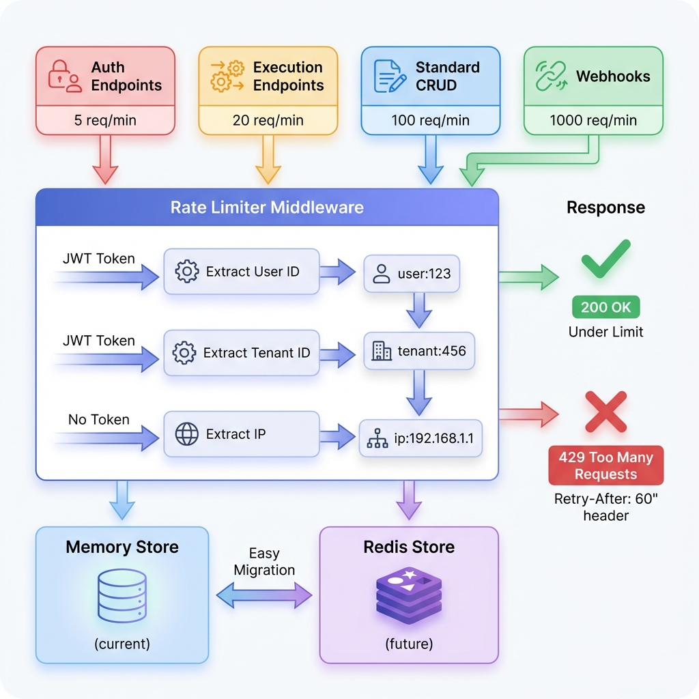

# Rate Limiting System

## Quick Start

The NanoFlow API now features a **granular, per-user rate limiting system** that protects against abuse while ensuring fair resource distribution.

### Current Limits

| Endpoint Type | Rate Limit | Example Routes |
|--------------|------------|----------------|
| 🔐 **Authentication** | 5 req/min | `/api/auth/login`, `/api/auth/register` |
| ⚡ **Execution** | 20 req/min | `/api/executions/*` |
| 📝 **Standard CRUD** | 100 req/min | `/api/workflows/*`, `/api/analytics/*` |
| 🔗 **Webhooks** | 1000 req/min | `/webhook/*` |

### How It Works

- **Authenticated users**: Rate limits are per-user (extracted from JWT)
- **Unauthenticated requests**: Rate limits are per-IP address
- **429 Responses**: Include `Retry-After` header with seconds until retry

### Architecture Diagram



## Documentation

📚 **Full Documentation**: [`RATE_LIMITING.md`](./RATE_LIMITING.md)
- Complete architecture overview
- Configuration guide
- Redis migration instructions
- Testing strategies
- Monitoring recommendations

⚡ **Quick Reference**: [`RATE_LIMITING_QUICK_REF.md`](./RATE_LIMITING_QUICK_REF.md)
- Current limits table
- Testing scripts
- Common troubleshooting

📋 **Implementation Summary**: [`RATE_LIMITING_IMPLEMENTATION.md`](./RATE_LIMITING_IMPLEMENTATION.md)
- All changes made
- Requirements checklist
- Next steps

☑️ **Redis Migration**: [`REDIS_MIGRATION_CHECKLIST.md`](./REDIS_MIGRATION_CHECKLIST.md)
- Step-by-step migration guide
- Testing procedures
- Rollback plan

## Example Response

When rate limited:

```json
{
  "error": "Too many requests",
  "message": "Rate limit exceeded for auth endpoints. Please try again in 60 seconds.",
  "retryAfter": 60,
  "tier": "auth"
}
```

Headers:
```
HTTP/1.1 429 Too Many Requests
Retry-After: 60
RateLimit-Limit: 5
RateLimit-Remaining: 0
RateLimit-Reset: 1642089600
```

## Testing

```bash
# Test auth endpoint (5 req/min limit)
for i in {1..6}; do
  curl http://localhost:4000/api/auth/login \
    -d '{"email":"test@test.com","password":"test"}'
done
# 6th request should return 429
```

## Adjusting Limits

Edit `api/src/middleware/ratelimit.middleware.ts`:

```typescript
const RATE_LIMIT_CONFIGS = {
    [RateLimitTier.AUTH]: {
        windowMs: 1 * 60 * 1000,  // 1 minute
        max: 5,                    // 5 requests
    },
    // ... other tiers
};
```

## Scaling to Multiple Instances

Currently using **in-memory storage** (single instance).

To scale horizontally:
1. Install Redis: `npm install rate-limit-redis redis`
2. Follow [`REDIS_MIGRATION_CHECKLIST.md`](./REDIS_MIGRATION_CHECKLIST.md)
3. Update configuration (no code changes needed)

## Files Modified

### New Files
- `api/src/middleware/ratelimit.middleware.ts` - Rate limiting middleware
- `docs/RATE_LIMITING.md` - Full documentation
- `docs/RATE_LIMITING_QUICK_REF.md` - Quick reference
- `docs/RATE_LIMITING_IMPLEMENTATION.md` - Implementation summary
- `docs/REDIS_MIGRATION_CHECKLIST.md` - Redis migration guide

### Modified Files
- `api/src/server.ts` - Applied endpoint-specific rate limiters

## Benefits

✅ **Security**: Prevents brute force attacks and resource exhaustion  
✅ **Fairness**: Per-user limits prevent noisy neighbors  
✅ **Scalability**: Redis-ready for horizontal scaling  
✅ **Developer-friendly**: Clear error messages and Retry-After headers  
✅ **Configurable**: Easy to adjust without code changes  

---

**Status**: ✅ Production Ready  
**Last Updated**: 2026-01-13  
**Version**: 1.0
